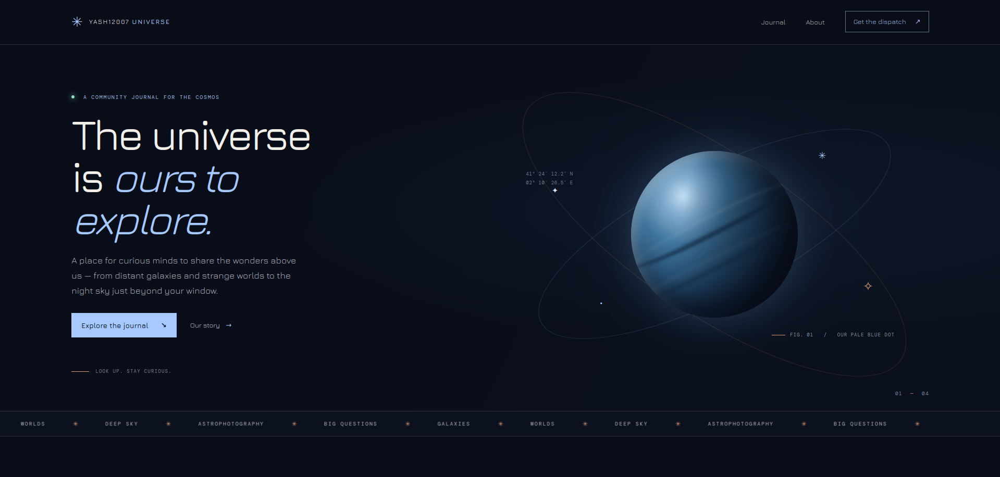

<p align="center">
  
</p>

<h1 align="center">Yash12007 Universe</h1>

<p align="center">
  A community journal for curious minds exploring space, galaxies, planets, celestial discoveries, and the night sky.
</p>

<p align="center">
  <a href="https://universe.yash12007.com">Visit the site</a> ·
  <a href="https://github.com/yash12007-com/Universe">Source code</a>
</p>

---

## About

Yash12007 Universe is a Jekyll-powered astronomy blog. Readers are welcome to contribute observing reports, explainers, astrophotography, and stories about celestial objects and space science. Submissions are reviewed before publication.

## Run locally

You'll need Ruby, RubyGems, and Bundler installed.

```bash
git clone https://github.com/yash12007-com/Universe.git
cd Universe
bundle install
bundle exec jekyll serve
```

Open [http://localhost:4000](http://localhost:4000). Jekyll rebuilds content changes automatically. Restart the server after editing `_config.yml`.

## Write a post

Create a Markdown file in `_posts/` using the filename format `YYYY-MM-DD-short-title.md`. Include front matter at the top:

```markdown
---
layout: default
title: "A night with Saturn"
subtitle: "A short description for the article page."
date: 2026-11-01 18:00:00 +0530
categories: [Planets, Observing]
---

Write your story in Markdown. Include reliable sources for factual claims
and credit any images you did not create.
```

Posts can optionally include `image`, `image_alt`, and `image_caption` fields. Put images in the repository (for example under `assets/images/`) and use a path that works on the deployed site. Keep posts original, accurate, accessible, and welcoming; use clear headings and add image alt text.

### Suggesting a post

If you don't want to submit a pull request, email [info@yash12007.com](mailto:info@yash12007.com) with a short pitch and a few lines about yourself. The maintainers will review submissions before publishing.

## Contribute with a pull request

1. Fork the repository and clone your fork.
2. Create a branch for your post or change.
3. Add your Markdown post to `_posts/` using the filename format above.
4. Preview locally with `bundle exec jekyll serve` when possible.
5. Commit your changes and open a pull request describing the contribution.

After review and merge, the deployed site will publish the post. Please don't commit generated `_site/` output, `.jekyll-cache/`, credentials, or private subscriber data.

## Newsletter

The signup form is present, but email collection is disabled until the site owner configures a newsletter provider. Set `newsletter_action` in `_config.yml` to the provider's supported form endpoint. Do not add subscriber addresses or private provider credentials to this repository.

## Project details

- **Site:** [universe.yash12007.com](https://universe.yash12007.com)
- **Framework:** Jekyll
- **Theme foundation:** Beautiful Jekyll, with a custom Universe layout and styling
- **Typography:** Jura
- **License:** See the repository's license file, if present; contact the maintainers before reusing project branding or artwork.

## Questions and issues

For bugs, accessibility concerns, or site suggestions, open a GitHub issue. For post ideas or editorial questions, email [info@yash12007.com](mailto:info@yash12007.com).
